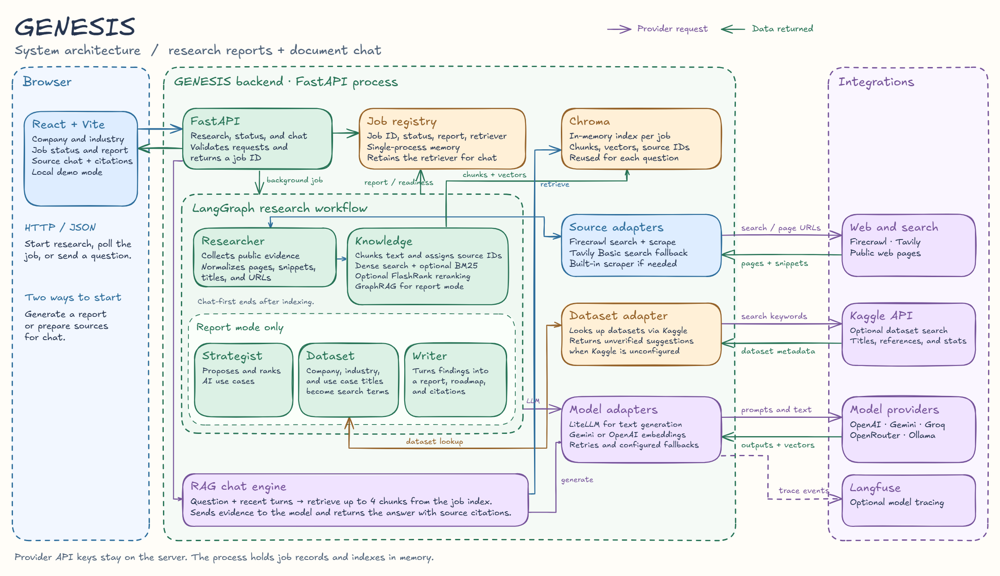
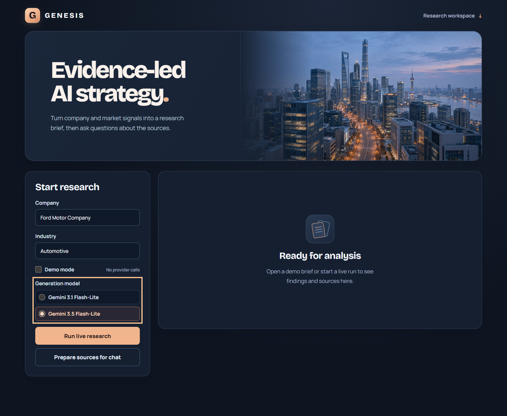
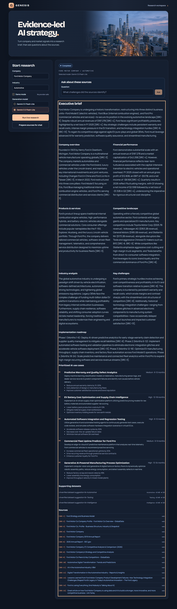
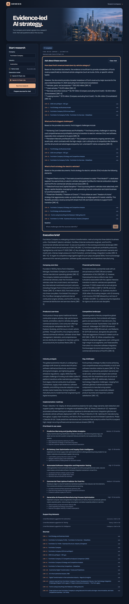

# GENESIS

GENESIS is a research and AI strategy application that turns a company name and an industry into a structured brief. It collects public sources, retrieves relevant evidence, and uses language models to propose AI use cases, supporting datasets, and an implementation roadmap.

The app also supports retrieval-augmented generation (RAG) chat. Users can ask follow-up questions about a research job’s sources or prepare those sources for chat without generating a full report.

## Architecture



The React frontend submits research requests to FastAPI and polls for job status. FastAPI runs a LangGraph workflow in the background. The Researcher collects public sources, and Knowledge splits documents into chunks, assigns citation IDs, and builds a job-scoped Chroma index. Report mode continues through Strategist, Dataset, and Writer.

Follow-up questions reuse the same index. The chat engine retrieves relevant chunks, sends them to the model as context, and returns an answer with source links. LiteLLM handles model calls. The React app lets users choose between two Gemini models for live runs, and the backend supports other configured generation providers.

Web research falls back from Firecrawl to Tavily to the built-in scraper. Model calls retry temporary errors and can use a configured fallback model.

## Live example

GENESIS researched **Ford Motor Company** in the **automotive** industry. The live run used Gemini 3.5 Flash-Lite, collected 15 sources, and generated five AI use cases. The chat reused that run's source index.



<details>
<summary>View the full Ford report</summary>



</details>

<details>
<summary>View the full Ford chat with source links</summary>

1. How does Ford's revenue break down by vehicle category?
2. What are Ford's biggest challenges?
3. What is Ford's strategy for electric vehicles?

The chat flagged that the retrieved sources lacked a vehicle-category revenue breakdown and gave the broader revenue categories it found.



</details>

## Run locally

Use `.env_template` as a guide to create a `.env` file in the project root. Set `GEMINI_API_KEY` for the default live workflow. Set `FIRECRAWL_API_KEY` or `TAVILY_API_KEY` to enable hosted web research. Set `LLM_FALLBACK_MODELS` if you want to configure backup models.

Free-tier quotas can be reached quickly. A live run may return a partial report or fail when a provider hits its limit. Demo mode works without provider keys.

Start the backend from the project root.

```bash
python -m pip install -r backend/requirements.txt
python -m uvicorn backend.main:app --reload
```

Start the frontend in a second terminal.

```bash
cd frontend
npm install
npm run dev
```

Open [http://localhost:5173](http://localhost:5173).
